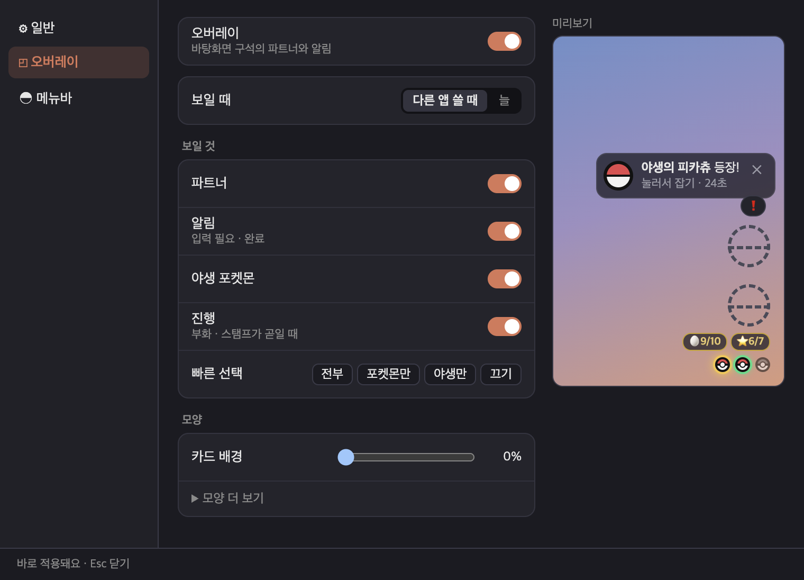

<h1 align="center">Tamer</h1>

<b>AI 코딩 에이전트를 길들이는 터미널</b> 
Claude Code · Codex · Gemini CLI · OpenCode를 폴더마다 셸과 함께 열고, 지금 무엇을 하는지·입력이 필요한지·끝났는지를 한눈에.

> **베타입니다.** 누구나 받아 써 볼 수 있어요. 문제나 아이디어는 [피드백](#피드백--문제-보고)으로 보내 주시면 됩니다.
> 이 문서는 **기능 안내**입니다. 버전마다 바뀐 점은 [Releases](../../releases) 노트에 있어요.

---

## 왜
- **에이전트가 지금 뭘 하는지 바로 보입니다**: 생각 중 · 파일 편집 · 명령 실행 · **입력 필요** · 완료 · 중단 · 실패를 탭과 바탕화면 오버레이에 표시합니다. 다른 앱을 쓰고 있어도 알 수 있어요.
- **에이전트를 가리지 않습니다**: 쓰던 터미널처럼 셸에서 `claude`, `codex`, `gemini`, `opencode`를 그대로 치면 됩니다. 설치 방식(nvm·Homebrew·npm…)이 달라도 내 터미널에서 되면 Tamer에서도 됩니다.
- **사용량이 늘 보입니다**: 모델 · 컨텍스트 · 5시간/7일 한도를 상단 막대로 표시합니다.
- **재미도 조금**: 작업을 끝낼 때마다 파티의 포켓몬이 차례로 레벨을 올리고 진화하며, 가끔 야생 포켓몬이 나타납니다(비공식 팬 기능).

## 어떻게 동작하나
1. 폴더를 열면 큰 칸에 **셸**이 열립니다(오른쪽 아래에도 셸 하나).
2. 셸에서 에이전트를 치거나 **⌘G**로 고르면, 그 칸이 에이전트 칸이 됩니다.
3. Tamer가 에이전트의 상태를 따라가며 탭·오버레이·상단 막대에 보여 줍니다.
4. 에이전트가 끝나면 그 자리는 다시 셸이 됩니다. 한 폴더에서 셸을 여러 개(⌘⇧T) 열어 에이전트를 나눠 쓸 수 있어요.

## 둘러보기
| ⌘G 에이전트 선택 | 셸 이름 · 대화 제목 (오른쪽 칸 접음) |
|---|---|
|  |  |

| 설정(⌘,) — 따로 뜨는 창: 일반 · 오버레이 · 메뉴바 |
|---|
|  |

- **셸 이름 · 대화 제목**: 셸이 둘 이상이면 왼쪽 셸 줄에 마우스를 올려 두세요 — 펼쳐지며 셸마다 이름 · 에이전트 · 상태가 보여요(마우스를 빼면 접힘). 이름은 직접 붙이거나(더블클릭 또는 우클릭 → 이름 바꾸기), 없으면 Claude Code · Codex가 붙인 대화 제목. 셸이 하나면 칸 제목줄에. 대화 내용은 읽지 않고, 설정 → 일반 → **세션 제목**으로 끌 수 있어요

- **에이전트 연결 창**(처음 한 번 자동, 이후 ⌘G → "⚙ 에이전트 연결 상태…"): 에이전트마다 연결 상태와 설치 위치, 없는 에이전트는 설치 명령
- **셸에서 직접 친 Claude도 연결**(선택): 연결 창의 버튼 한 번이면 셸에 `claude`를 쳐도 ⌘G처럼 5시간 · 주간 한도와 ctx %가 보여요. 셸 설정 파일(`~/.zshrc` 등) 끝에 **Tamer 셸 안에서만 동작하는 한 줄**을 넣고(넣기 전 보여 주고 물어봄), 같은 창에서 해제할 수 있어요. 연결 전엔 상단 바에 `5h·7d ?`, ctx는 `≈` 추정치
- **변경 사항 칸**: 에이전트가 바꾼 파일 목록 · 나란히 비교 · 파일 단위 되돌리기(git 폴더). 제목에 지금 브랜치와 올릴·받을 커밋 수(`⎇ main ↑2`)
- **다른 폴더에서 띄운 에이전트**: 셸에서 `cd`로 옮겨 띄워도 그 위치에서 상태·사용량을 따라가고, 탭 폴더 밖이면 안내 줄에서 **새 탭으로 옮기기**(실행 중인 채로)
- **바탕화면 오버레이**: 다른 앱을 쓰는 동안 "입력 필요", "셸 2 완료!" 같은 알림. 설정에서 끄거나 보일 것만 고를 수 있어요(포켓몬만 · 야생 포켓몬만, 카드 배경 투명도, 그림자). 카드 배경은 기본 0%라 처음엔 글자 없이 메인 파트너와 탭마다 몬스터볼(빛남 작업 중 · 빨강 입력 필요 · 초록 완료)만 — 마우스를 올리면 "폴더 — 상태", 배경을 올리면 글자 카드. "보일 때"를 "늘"로 하면 Tamer가 앞에 있어도 보여요. 창을 닫아 탭이 없으면 파티 카드(누르면 포켓몬 창)
- **오른쪽 칸 접기(⌘\\)**: 파트너·변경 사항·셸 칸을 접으면 에이전트 칸이 창 전체 — 그동안 파트너는 바탕화면 오버레이로
- **메뉴바 아이콘**: 화면 맨 위 몬스터볼 — 또는 **메인 파트너**(설정 → 메뉴바 → 아이콘): 늘 움직이고 일하는 동안 빨라지며, 입력이 필요하면 빨간 !, 야생이 나오면 발밑에 풀숲. 옆에는 기다리는 탭 수, 또는 5시간 · 주간 남은 % `97 · 81%`(50% 이하 노랑 · 20% 이하 빨강). **왼쪽 클릭**: 작은 대시보드(홈: 메인 파트너·파티·사용 한도, 야생이 나오면 그 자리에서 잡기 · 작업: 오늘·부화기·Tamer 탭 — 줄을 누르면 포켓몬 창의 그 자리로) · **오른쪽 클릭**: 메뉴(탭 상태·한도·`↻ 한도 새로 고침`·오버레이와 테마 빠른 설정·설정 창·포켓몬 창 열기)
- **Tamer 밖 작업도 포켓몬에(선택, 처음 한 번 물어봄)**: 다른 터미널·Claude 앱의 Code·Codex 앱에서 끝낸 Claude Code·Codex 작업도 탭과 같은 규칙으로 레벨·코인·야생에 반영 — 탭 작업처럼 파티가 차례로 받아 커요. Claude 앱·ChatGPT의 일반 채팅은 이 맥에 기록이 없어 셀 수 없어요
- **백그라운드**: 창을 닫아도 메뉴바에 남아요(Dock 아이콘은 숨김) — 터미널은 끝나고 대시보드·한도·야생은 계속, 창을 다시 열면 지난 탭이 돌아와요. 완전히 끄기는 ⌘Q · 메뉴바 대시보드나 메뉴의 종료. 설정에서 끄거나 "로그인할 때 열기"를 켤 수 있어요
- **대화 없이 한도 보기**: Codex는 Codex 앱 서버에 계정 한도만 물어봐요(15분마다, 대화 안 함). Claude는 **켠 경우에만**(처음 한 번 물어봐요) Anthropic에서 사용률을 읽어요 — 아래 "데이터와 개인정보". 상단 바 5h·7d를 누르면 바로 새로 고침
- **설정(⌘,)**: Tamer 창 없이 따로 뜨는 창(제목 줄로 옮김, Esc · ⌘W로 닫음) — 왼쪽에서 **일반**(테마 · 오른쪽 칸 · 일하는 탭 테두리 · 세션 제목) · **오버레이**(켜기 · 보일 때 · 보일 것 · 카드 배경, 옆 미리보기로 바로 확인) · **메뉴바**를 골라요. 바꾸면 바로 적용돼요
- **라이트 테마**: 앱 창·오버레이·터미널 색이 함께 바뀌어요. 에이전트 화면 색은 그 에이전트 설정(Claude Code는 `/theme`)
- **일하는 탭이 한눈에**: 에이전트가 일하는 동안 그 탭 테두리를 색이 돌며 감싸요
- **오른쪽 칸 너비**: 큰 칸과 오른쪽 칸 사이 경계를 끌어서 조절, 두 번 누르면 처음대로
- **맡겨 둔 작업 보기**: 작업한 지 `· 12분`, 입력을 기다린 지 `· 4분째`, 끝나면 `23분 걸림`. 작업 중인데 10분 넘게 새 움직임이 없으면 `⏳ 변화 없음`(멈췄을 수 있다는 추정 — 명령 실행 중엔 안 뜸)
- **작성 창(⌘E)**: 긴 프롬프트를 편하게 쓰고 한 셸 또는 모든 셸에 보내기
- **터미널에서 찾기(⌘F)**: 긴 에이전트 출력에서 글자 찾기 — 모든 결과 강조, "2/5"처럼 위치 표시
- **⌘-클릭**: 터미널에 나온 링크(에이전트가 보여 준 출처 등)는 브라우저로, 파일 경로(`src/a.ts:12`)는 편집기에서 그 줄로, `index.html`·그림·PDF는 기본 앱(브라우저 등)으로
- **비용 표시**: Claude는 상단 막대에 비용, 셸에서 직접 띄운 Claude·Codex는 토큰 수 × API 가격으로 계산한 추정치 `≈$`

## 포켓몬 파트너 (비공식 팬 기능)
최대 5마리의 **파티**가 있어요. 어디서 작업을 끝내든(Tamer의 어느 탭이든, 켜 두면 Tamer 밖 작업도) 파티가 차례로 한 마리씩 레벨을 올리고 원작 조건대로 진화해요. 파티 1번은 **메인 파트너** — 모든 탭의 파트너 칸 · 바탕화면 오버레이 · 메뉴바에 같은 한 마리가 보여요. 가끔 야생 포켓몬이 나타나고(⌘B로 몬스터볼, 잡으면 **파티에 넣기**), 다른 앱을 쓰는 중이면 바탕화면에 작은 알림이 떠서 누르면 알림 옆 작은 창에서 바로 잡아요(Tamer 창을 열지 않아요).

- **포켓몬 고르기 창**: 처음 켜면 한 번 저절로 떠요 — 스타터 셋 중 하나(1 · 2 · 3, Enter)를 고르면 메인 파트너가 돼요. 파티가 비면 박스의 포켓몬을 골라 파티에 넣어요. 그 밖엔 "포켓몬이 없어요 **[포켓몬 고르기]**" 단추로 열어요

포켓몬 창(⌘P · ⌘D — Tamer 창 없이 따로 뜨는 창) 하나에서 탭 다섯을 오가요 — 모두 같은 방식(카드를 고르면 오른쪽 미리보기 → **메인 파트너로** · **파티에 넣기**, 방향키 · Enter · Esc · `/` 검색):
- **🏠 홈(⌘P)**: 메인 파트너, 오늘 끝낸 작업 수 · 🔥 며칠 연속 · 최근 7일, 부화기(사용 한도는 메뉴바 대시보드와 상단 바에)
- **🎒 내 포켓몬(M)**: 맨 위 **파티 줄**(5칸 — 1번 메인 · 다음 차례 표시)에서 파티를 넣고 빼고 메인을 정해요. 아래엔 잡은 개체를 카드로(레벨 · 다음 진화 레벨 · 파티 몇 번인지), 최근 잡은 순 · 번호 · 이름 · 레벨 · 파티 먼저 정렬. 상세에 어디서 · 어떤 에이전트 작업 중에 잡았는지, 진화 이력이 보여요
- **📕 도감(⌘D)**: 만난·잡은 포켓몬, 위쪽 "새로 잡은" 줄(24시간 안), NEW = 아직 안 본 것
- **🪙 포켓코인 · 🛒 상점(S) · 👜 가방(I)**: 작업을 끝낼 때마다 코인이 쌓이고(하루 상한 있음), 상점에서 슈퍼볼·하이퍼볼·마스터볼·이상한사탕·향을 사요. 산 볼은 야생 카드에서 골라 던지고, 사탕은 레벨 +1, 향은 1시간 동안 야생이 두 배. 실제 돈과는 상관없어요
- **⭐ 연구 스탬프 · 주간 대발견**: 작업을 끝낸 날마다 🏠 홈에 스탬프 하나(연속이 아니어도 돼요), 7개가 모이면 전설 포켓몬과 확정으로 만나요 — 도망가지 않고 앱을 다시 켜도 남아요. 상점의 전설의 향으로 다음 전설을 고를 수 있어요
- **🥚 알 · 🎓 졸업**: 상점에서 산 알을 부화기에 넣으면 어느 폴더든 작업을 끝낼 때마다 부화가 가까워져요. Lv 100이 된 포켓몬은 졸업하고 코인과 알을 받아요 — 파티에 두고 메인 파트너로 계속 함께해도 돼요
- **💎 진화의 돌 · 🔗 연결의끈 · ✨ 빛나는부적**: 진화의 돌로 돌·도구로 진화하는 포켓몬을 바로 진화시키고, 이브이처럼 갈래가 있으면 직접 골라요. 교환으로 진화하는 포켓몬(근육몬 · 윤겔라 · 고우스트 …)은 연결의끈으로. 빛나는부적을 가지고 있으면 이로치(✨)가 두 배로 자주 나와요
- **전설의 길 · 환상 리서치**: 세대 도감을 채우면 그 세대 전설이 대발견에 열리고, 리서치 "뮤를 찾아서"를 끝내면 뮤를 만나요
- **검색**(`/` 또는 ⌘F, 포켓몬 GO 검색어처럼): 이름 · 번호 `25` · 범위 `1-151` · 타입 `불꽃` · 지역 `관동` · `new` · `✨` · `잡음` · `파티` · `전설` · `환상` · `age0`(24시간 안). `&` 그리고 · `,` 또는 · `!` 제외 — 예: `불꽃,물&!잡음`. 결과만 보여요
- 잡은 뒤 야생 카드의 **📕 도감에서 보기**를 누르면 도감에서 그 포켓몬이 열려요
- 메뉴바 대시보드에서 파티 그림을 누르면 바로 메인 파트너가 돼요
- 파트너 칸 클릭 = 공격·애교, 우클릭 = 메뉴(메인 파트너 바꾸기 · 도감 · 야생 켜기·끄기)

## 지원하는 에이전트
| 에이전트 | 상태 | 비고 |
|---|---|---|
| Claude Code | 🟢 전체 | 사용량(모델·ctx·5h·7d·비용) |
| Codex | 🟢 전체 | 사용량(모델·ctx·5h·7d) |
| Gemini CLI | 🟢 전체 | 에이전트 연결 창의 **"확장 연결"** 버튼 한 번(안 하면 🟡) |
| OpenCode | 🟢 전체 | |
| 그 밖의 CLI 에이전트 | 🟡 기본 | `~/.cvim/agents.json`에 등록하면 작업 중/대기, 오래 일하다 끝나면 완료로 봄 |

🟢 전체 = 생각 중·도구·입력 필요·완료·중단까지, 파티 성장·야생 포켓몬 / 🟡 기본 = 작업 중·대기(완료는 추정, 성장 절반, 야생 없음)

## 설치
**필요한 것**: macOS 13 이상 · 위 에이전트 중 하나 이상 · 인터넷(포켓몬 이미지를 처음 한 번 받음) · 셸은 무엇이든(zsh·bash·fish·tcsh …, 내 기본 셸이 그대로 열림)

1. 이 저장소의 [**Releases**](../../releases)에서 내 맥에 맞는 DMG를 받습니다(로그인 없이).
   - Apple Silicon(M1~): `Tamer-<버전>-arm64.dmg` · Intel: `Tamer-<버전>-x64.dmg` (메뉴 → 이 Mac에 관하여 → "칩"으로 확인)
2. DMG를 열고 **Tamer**를 **Applications**로 끌어 놓은 뒤, **Applications에서** 엽니다(DMG 창에서 바로 열면 압축된 이미지에서 읽느라 매번 느려요).
3. **처음 한 번만**: Apple 공증 전 베타라 macOS가 한 번 막습니다. 둘 중 하나로 여세요.
   - **시스템 설정 → 개인정보 보호 및 보안** 맨 아래 "Tamer이(가) 차단되었습니다" 옆 **그래도 열기**
   - 또는 터미널: `xattr -dr com.apple.quarantine /Applications/Tamer.app`
   - (macOS 15부터는 Finder 우클릭 → 열기로는 넘어가지 않아요)

**업데이트**: 새 버전 DMG로 Applications의 Tamer를 덮어쓰면 됩니다. 데이터는 그대로 남아요(저장 형식을 바꾸는 업데이트는 바꾸기 전 사본을 `~/.cache/tamer/backup/`에 남겨요).

## 주요 단축키
| 키 | 동작 |
|---|---|
| ⌘O / ⌘T | 폴더 열기 / 새 탭 |
| ⌘G | 에이전트 선택(↑↓ · 숫자 · Enter · Esc) |
| ⌘⇧T · ⌃⌘1~9 | 이 폴더에 셸 하나 더 · 셸 이동 (셸 줄 더블클릭 = 이름 바꾸기) |
| ⌘1~9 · ⌘W | 탭 이동 · 닫기 |
| ⌘E | 프롬프트 작성 창 |
| ⌘F | 터미널에서 찾기(↵ 다음 · ⇧↵ 이전 · Esc 닫기). 포켓몬 창에서는 도감 검색 |
| ⇧↵ · ⌘⌫ · ⌘←→ | 프롬프트 줄바꿈 · 커서 앞 줄 지우기 · 줄 처음/끝 |
| ⌘-클릭 | 터미널의 링크(웹 주소)는 브라우저로, 파일 경로(`src/a.ts:12`)는 편집기로, `index.html`·그림·PDF는 기본 앱으로 |
| ⌘, | 설정(일반 · 오버레이 · 메뉴바) |
| ⌘\\ | 오른쪽 칸 접기 · 펴기 |
| ⌘⌥↵ | 큰 칸 ↔ 오른쪽 아래 셸 바꾸기 |
| ⌘P · ⌘D · ⌘B | 홈 · 도감 · 야생 포켓몬에 몬스터볼 |
| / 또는 ⌘F · M · S · I | (포켓몬 창) 검색 · 도감 ↔ 내 포켓몬 · 상점 · 가방 |
| ⌘= ⌘- ⌘0 | 글자 크기 |

## 데이터와 개인정보
- 모든 데이터는 **이 맥에만** 있습니다: `~/.cache/tamer/`(폴더 기록, 포켓몬·파티·도감, 포켓코인 기록(하루별 합계만), 상태 파일), `~/Library/Application Support/Tamer/`(창 설정). 데이터 파일이 깨져 읽히지 않으면 덮어쓰기 전에 원본을 `~/.cache/tamer/backup/corrupt/`에 남겨 둡니다
- Tamer는 사용자 데이터(폴더·파일·대화·사용량 기록)를 밖으로 보내지 않습니다. 인터넷은 받기에만 씁니다: 포켓몬 이미지·이름(PokéAPI, GitHub의 스프라이트), `≈$` 비용 추정용 모델 가격표(GitHub의 LiteLLM 가격표, 필요할 때 하루 한 번).
- **Tamer 밖 작업(선택, 처음에 물어봄)**: 켜면 Claude Code·Codex가 이 맥에 남기는 기록(`~/.claude/projects` · `~/.codex/sessions`)에서 '작업이 끝났다'는 줄의 폴더·걸린 시간·실행한 곳과, 오늘 쓴 토큰 수·모델 이름(메뉴바 대시보드의 오늘 사용량)만 읽어요. 대화 내용·명령·파일은 읽지 않고, 읽은 것을 저장하거나 보내지 않아요(어디까지 읽었는지도 메모리에만). Tamer가 켜져 있는 동안만 세요.
- **Claude 한도 바로 읽기(선택, 기본은 처음에 물어봄)**: 켜면 Claude Code의 로그인 정보를 macOS 키체인에서 읽어 **Anthropic에 로그인 토큰을 담아** 이 계정의 5시간·주간 사용률만 받아 와요(켤 때·Tamer가 뜰 때·새로 고침 때·15분마다). 키체인은 Tamer 안의 `cvim-core`가 직접 읽고(그래서 "항상 허용"은 Tamer에게만 붙어요) 로그인 정보 중 접근 토큰만 꺼내요. 토큰은 메모리에만 두고 저장·기록하지 않으며 Anthropic 외에는 보내지 않아요. 이 주소는 **공개되지 않은(비공식) 주소**라 바뀌거나 막힐 수 있고, Anthropic 약관상 허용되는지는 확인하지 못했어요. 켤 때·Tamer가 뜰 때·로그인이 만료됐을 때·새로 고침을 누를 때 macOS가 키체인 확인 창을 띄울 수 있어요(거부하면 그 실행 동안 다시 묻지 않아요). 끄려면 설정 › 일반 › 한도. Codex 한도는 Codex 프로그램이 직접 받아 오고, Tamer는 Codex 로그인 정보를 읽지 않아요.
- 에이전트 **대화 내용은 저장하지 않습니다.** 상태 표시를 위해 이벤트 종류 · 도구 이름 · 모델 이름 · 토큰 수를 읽고, 이 맥에 남기는 것은 이벤트 종류 · 도구 이름 · "입력 필요/쉬는 중" 같은 종류 값뿐입니다(7일 뒤 정리). 에이전트가 다룬 파일 경로 · 명령 · 메시지 글은 남기지 않습니다.
- **세션 제목**(켜져 있을 때): Claude Code 대화 기록에서는 제목 줄(`ai-title` 등)만, Codex는 세션 목록 `~/.codex/session_index.jsonl`의 제목만 읽고, 터미널 창 제목도 씁니다. 제목은 메모리에만 두고, 직접 붙인 셸 이름만 탭 복원용으로 이 맥에 남아요. 끄면 읽지 않아요.
- 에이전트는 내 터미널과 같은 환경으로 실행됩니다(시작할 때 셸 환경을 한 번 읽고, 메모리에만 둠).
- Claude는 Tamer가 띄울 때(또는 직접 켠 "셸에서 친 Claude도 연결"이 있을 때 Tamer 셸 안에서만) 상태 표시용 설정이 붙고, `~/.claude/settings.json`은 건드리지 않습니다. 연결을 켜면 셸 설정 파일에 표시된 블록 하나가 들어가고(사본은 `~/.cache/tamer/backup/shell-rc`), 해제하면 그 블록만 빠집니다.

## 피드백 · 문제 보고
- **GitHub Issues**: 이 저장소의 [Issues](../../issues)에 바로 써 주세요(GitHub 계정 필요). 이슈는 **누구나 볼 수 있으니** 이름 · 메일 · 회사 · 프로젝트 이름 같은 개인 정보는 넣지 마세요.
- **메일**: GitHub 계정이 없거나 공개하기 싫은 내용이면 메뉴 **Tamer → 피드백 보내기…** → 메일(**yeomjae5766@gmail.com**) 초안이 열립니다. 받은 메일은 개인 정보를 뺀 뒤 Issues에 옮겨 적어요.
- 문제가 있었다면 메뉴 **Tamer → 진단 정보 복사** 후 이슈나 메일에 붙여 주세요. 버전 · macOS · 에이전트 연결 상태 · 최근 앱 기록이 들어가고, 대화 내용 · 명령어 · 파일 이름은 없으며 폴더 이름은 "폴더1"처럼 가려집니다.
- 적어 주시면 좋은 것: 무엇을 했고 → 무엇을 기대했고 → 무엇이 보였는지, 스크린샷(Tamer 창만)

## 알려진 문제
- 새 버전을 **처음** 열 때 macOS가 앱을 검사해서 10~20초 걸릴 수 있어요(Apple 공증 전 베타라서). 두 번째부터는 1~2초예요.
- 셸 설정(`~/.zshrc`)이 오래 걸리면 창·탭은 바로 뜨지만, 에이전트 시작(⌘G 목록 포함)은 셸 설정을 다 읽을 때까지(최대 15초) 기다려요. 그래도 못 읽으면 알림이 뜨고 에이전트가 일부 환경 변수 없이 실행될 수 있어요.
- 셸을 연 직후(3초 안)에 에이전트로 바꾸면 시작이 조금 늦어요(셸 시작이 끝난 뒤 바꿈).
- 셸에서 직접 띄운 Claude·Codex의 비용은 토큰 수 × API 가격으로 계산한 추정치(`≈$`)예요(5h·7d는 지난 값 — Claude 한도 바로 읽기를 켜면 대화 없이도 새 값).
- Claude 한도 바로 읽기는 공개되지 않은 주소를 써서, Anthropic이 바꾸면 갑자기 안 될 수 있어요(그때는 응답할 때 받은 값으로 돌아가요). 키체인 확인 창에서 거부했거나 로그인이 만료된 채면 그 실행 동안은 눌러야(메뉴바 `↻ 한도 새로 고침` 또는 상단 바 5h·7d) 다시 읽어요.
- Windows · Linux는 아직 지원하지 않습니다.

## 지우기
1. ("셸에서 친 Claude도 연결"을 켰다면, 먼저) ⌘G → ⚙ 에이전트 연결 상태 → **연결 해제**. 이미 앱을 지웠다면 셸 설정 파일(`~/.zshrc` · `~/.bash_profile` · `~/.config/fish/config.fish` 중 쓰는 것)에서 `# >>> Tamer: Claude 연결` 부터 `# <<< Tamer: Claude 연결 <<<` 까지 지우세요(Tamer 밖에서는 아무 일도 하지 않는 줄이라 남아 있어도 동작엔 영향 없음)
2. Tamer 종료 → Applications에서 Tamer를 휴지통으로
3. (데이터까지) `~/.cache/tamer`, `~/Library/Application Support/Tamer` 삭제
4. (Gemini 확장을 연결했다면) `gemini extensions uninstall cvim`

## 라이선스 · 면책
MIT — [LICENSE](LICENSE) 참고. MIT는 이 저장소의 원본 소스 코드에만 적용되며, 앱을 통해 접근하는 제3자의 상표·아트워크·데이터에 대한 권리는 주지 않습니다. Tamer에 들어 있는 오픈소스와 그 라이선스는 메뉴 **Tamer → 오픈소스 고지**에 있습니다.

Tamer의 포켓몬 파트너 기능은 비공식·비상업 팬 기능입니다. Nintendo, Game Freak, Creatures Inc., The Pokémon Company와 제휴·보증·후원·승인 관계가 없습니다. "포켓몬(Pokémon)"과 관련 명칭·캐릭터·이미지는 각 권리자의 상표 및 저작물이며, 이 프로젝트는 어떤 포켓몬 지식재산에 대해서도 소유권이나 권리를 주장하지 않습니다.

- 앱과 릴리즈 파일(DMG)에는 포켓몬 에셋이 들어 있지 않습니다. 포켓몬 이름·그림은 공개 PokéAPI(와 그 스프라이트 저장소)에서 실행 중에 받아 사용자의 맥에만 캐시하며, 그 그림의 권리는 각 권리자에게 있습니다.
- 이 저장소의 그림(README 스크린샷 등)에는 포켓몬 이미지를 넣지 않습니다.
- Tamer는 무료로 배포하며 판매하지 않습니다.
- 권리자께서 우려가 있으시면 [이슈](../../issues)를 열거나 yeomjae5766@gmail.com으로 연락 주세요. 신속히 대응하겠습니다.
- 이 프로젝트는 어떠한 보증도 없이 "있는 그대로" 제공됩니다. 이 고지는 법률 자문이 아닙니다.
