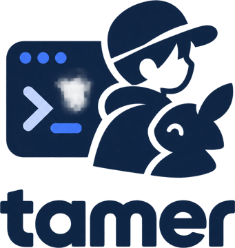
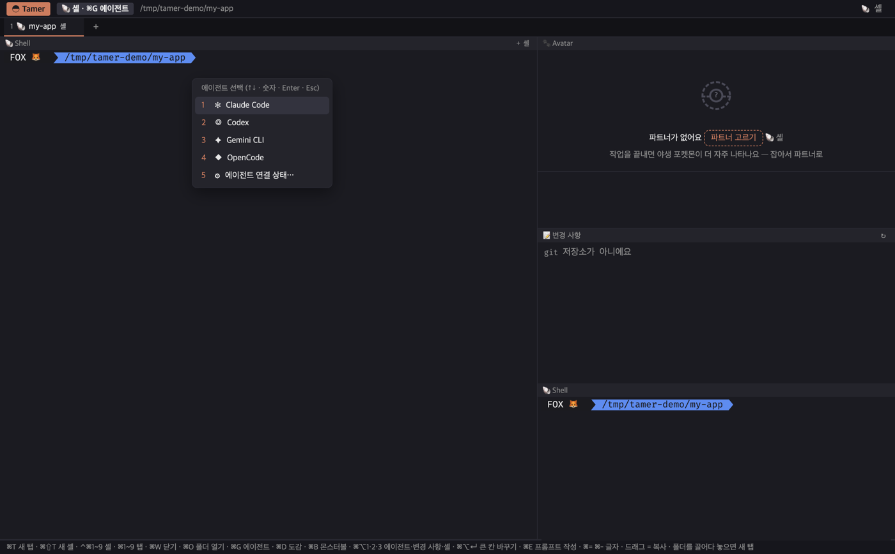
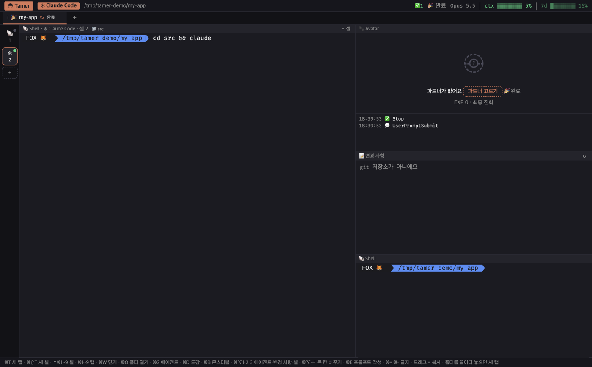

<h1 align="center">Tamer</h1>

<b>AI 코딩 에이전트를 길들이는 터미널</b> 
Claude Code · Codex · Gemini CLI · OpenCode를 폴더마다 셸과 함께 열고, 지금 무엇을 하는지·입력이 필요한지·끝났는지를 한눈에.

> **비공개 베타입니다.** 받은 분만 써 주세요. 문제나 아이디어는 [피드백](#피드백--문제-보고)으로 보내 주시면 됩니다.

---

## 왜
- **에이전트가 지금 뭘 하는지 바로 보입니다**: 생각 중 · 파일 편집 · 명령 실행 · **입력 필요** · 완료 · 중단 · 실패를 탭과 바탕화면 오버레이에 표시합니다. 다른 앱을 쓰고 있어도 알 수 있어요.
- **에이전트를 가리지 않습니다**: 쓰던 터미널처럼 셸에서 `claude`, `codex`, `gemini`, `opencode`를 그대로 치면 됩니다. 설치 방식(nvm·Homebrew·npm…)이 달라도 내 터미널에서 되면 Tamer에서도 됩니다.
- **사용량이 늘 보입니다**: 모델 · 컨텍스트 · 5시간/7일 한도를 상단 막대로 표시합니다.
- **재미도 조금**: 작업을 끝낼 때마다 폴더의 파트너 포켓몬이 경험치를 얻고 진화하며, 가끔 야생 포켓몬이 나타납니다(비공식 팬 기능).

## 어떻게 동작하나
1. 폴더를 열면 큰 칸에 **셸**이 열립니다(오른쪽 아래에도 셸 하나).
2. 셸에서 에이전트를 치거나 **⌘G**로 고르면, 그 칸이 에이전트 칸이 됩니다.
3. Tamer가 에이전트의 상태를 따라가며 탭·오버레이·상단 막대에 보여 줍니다.
4. 에이전트가 끝나면 그 자리는 다시 셸이 됩니다. 한 폴더에서 셸을 여러 개(⌘⇧T) 열어 에이전트를 나눠 쓸 수 있어요.

## 둘러보기
| ⌘G 에이전트 선택 | 여러 셸 · 하위 폴더에서 띄운 에이전트 |
|---|---|
|  |  |

- **에이전트 연결 창**(처음 한 번 자동, 이후 ⌘G → "⚙ 에이전트 연결 상태…"): 에이전트마다 연결 상태와 설치 위치, 없는 에이전트는 설치 명령
- **변경 사항 칸**: 에이전트가 바꾼 파일 목록 · 나란히 비교 · 파일 단위 되돌리기(git 폴더)
- **다른 폴더에서 띄운 에이전트**: 셸에서 `cd`로 옮겨 띄워도 그 위치에서 상태·사용량을 따라가고, 탭 폴더 밖이면 안내 줄에서 **새 탭으로 옮기기**(실행 중인 채로)
- **바탕화면 오버레이**: 다른 앱을 쓰는 동안 "입력 필요", "셸 2 완료!" 같은 알림
- **작성 창(⌘E)**: 긴 프롬프트를 편하게 쓰고 한 셸 또는 모든 셸에 보내기

## 지원하는 에이전트
| 에이전트 | 상태 | 비고 |
|---|---|---|
| Claude Code | 🟢 전체 | 사용량(모델·ctx·5h·7d·비용) |
| Codex | 🟢 전체 | 사용량(모델·ctx·5h·7d) |
| Gemini CLI | 🟢 전체 | 에이전트 연결 창의 **"확장 연결"** 버튼 한 번(안 하면 🟡) |
| OpenCode | 🟢 전체 | |
| 그 밖의 CLI 에이전트 | 🟡 기본 | `~/.cvim/agents.json`에 등록하면 작업 중/대기, 오래 일하다 끝나면 완료로 봄 |

🟢 전체 = 생각 중·도구·입력 필요·완료·중단까지, 파트너 경험치·야생 포켓몬 / 🟡 기본 = 작업 중·대기(완료는 추정, 경험치 절반, 야생 없음)

## 설치
**필요한 것**: macOS 13 이상 · 위 에이전트 중 하나 이상 · 인터넷(포켓몬 이미지를 처음 한 번 받음) · 셸은 무엇이든(zsh·bash·fish·tcsh …, 내 기본 셸이 그대로 열림)

1. 받은 링크의 **Releases**에서 내 맥에 맞는 DMG를 받습니다.
   - Apple Silicon(M1~): `Tamer-<버전>-arm64.dmg` · Intel: `Tamer-<버전>-x64.dmg` (메뉴 → 이 Mac에 관하여 → "칩"으로 확인)
   - 비공개 저장소라 **초대받은 GitHub 계정으로 로그인**해야 받을 수 있어요.
2. DMG를 열고 **Tamer**를 **Applications**로 끌어 놓습니다.
3. **처음 한 번만**: Apple 공증 전 베타라 macOS가 한 번 막습니다. 둘 중 하나로 여세요.
   - **시스템 설정 → 개인정보 보호 및 보안** 맨 아래 "Tamer이(가) 차단되었습니다" 옆 **그래도 열기**
   - 또는 터미널: `xattr -dr com.apple.quarantine /Applications/Tamer.app`
   - (macOS 15부터는 Finder 우클릭 → 열기로는 넘어가지 않아요)

**업데이트**: 새 버전 DMG로 Applications의 Tamer를 덮어쓰면 됩니다. 데이터는 그대로 남아요.

## 주요 단축키
| 키 | 동작 |
|---|---|
| ⌘O / ⌘T | 폴더 열기 / 새 탭 |
| ⌘G | 에이전트 선택(↑↓ · 숫자 · Enter · Esc) |
| ⌘⇧T · ⌃⌘1~9 | 이 폴더에 셸 하나 더 · 셸 이동 |
| ⌘1~9 · ⌘W | 탭 이동 · 닫기 |
| ⌘E | 프롬프트 작성 창 |
| ⇧↵ · ⌘⌫ · ⌘←→ | 프롬프트 줄바꿈 · 커서 앞 줄 지우기 · 줄 처음/끝 |
| ⌘⌥↵ | 큰 칸 ↔ 오른쪽 아래 셸 바꾸기 |
| ⌘D · ⌘B | 도감 · 야생 포켓몬에 몬스터볼 |
| ⌘= ⌘- ⌘0 | 글자 크기 |

## 데이터와 개인정보
- 모든 데이터는 **이 맥에만** 있습니다: `~/.cache/tamer/`(폴더 기록, 파트너·도감, 상태 파일), `~/Library/Application Support/Tamer/`(창 설정)
- Tamer가 밖으로 보내는 것은 없습니다. 인터넷은 포켓몬 이미지·이름 받기(PokéAPI, GitHub의 스프라이트)에만 씁니다.
- 에이전트 **대화 내용은 저장하지 않습니다.** 상태 표시를 위해 이벤트 종류 · 도구 이름 · 짧은 인자(파일 경로 등) · 모델 이름 · 토큰 수만 읽습니다.
- 에이전트는 내 터미널과 같은 환경으로 실행됩니다(시작할 때 셸 환경을 한 번 읽고, 메모리에만 둠).
- Claude는 Tamer가 띄울 때만 상태 표시용 설정이 붙고, `~/.claude/settings.json`은 건드리지 않습니다.

## 피드백 · 문제 보고
- 메뉴 **Tamer → 피드백 보내기…** → 메일(**yeomjae5766@gmail.com**) 초안이 열립니다.
- 문제가 있었다면 메뉴 **Tamer → 진단 정보 복사** 후 메일에 붙여 주세요. 버전 · macOS · 에이전트 연결 상태 · 최근 앱 기록이 들어가고, 대화 내용 · 명령어 · 파일 이름은 없으며 폴더 이름은 "폴더1"처럼 가려집니다.
- 적어 주시면 좋은 것: 무엇을 했고 → 무엇을 기대했고 → 무엇이 보였는지, 스크린샷(Tamer 창만)

## 알려진 문제
- 셸 설정(`~/.zshrc`)이 오래 걸리면 처음 ⌘G 목록이 최대 3초 늦게 뜰 수 있어요.
- 셸을 연 직후(3초 안)에 에이전트로 바꾸면 시작이 조금 늦어요(셸 시작이 끝난 뒤 바꿈).
- 셸에서 직접 띄운 Claude는 비용($)이 표시되지 않아요(5h·7d는 지난 값).
- Windows · Linux는 아직 지원하지 않습니다.

## 지우기
1. Tamer 종료 → Applications에서 Tamer를 휴지통으로
2. (데이터까지) `~/.cache/tamer`, `~/Library/Application Support/Tamer` 삭제
3. (Gemini 확장을 연결했다면) `gemini extensions uninstall cvim`

## 라이선스 · 고지
- 메뉴 **Tamer → 오픈소스 고지**: Tamer에 들어 있는 오픈소스와 라이선스
- Pokémon은 **비공식 팬 기능**입니다. 포켓몬 이름·이미지의 권리는 Nintendo / Creatures / GAME FREAK / The Pokémon Company에 있으며, 이미지는 앱에 들어 있지 않고 실행 중 받아 이 맥의 캐시에만 둡니다.
